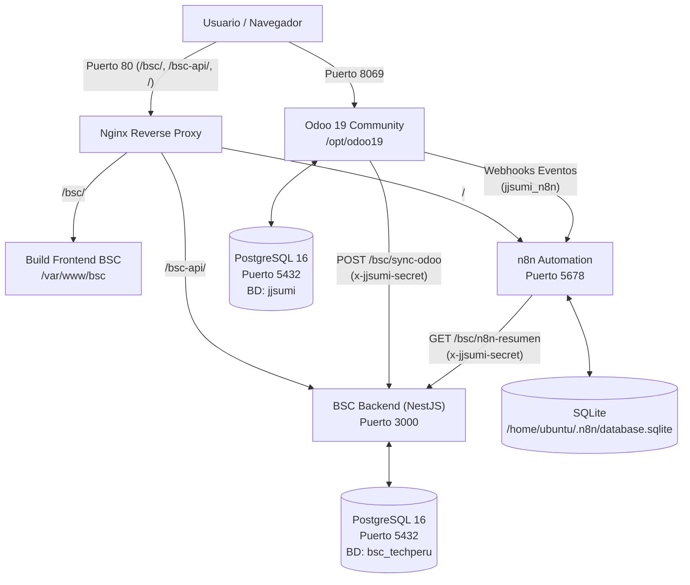

# 01 — Arquitectura e Infraestructura del Servidor

El proyecto corre de manera nativa sobre **Ubuntu 24.04** en AWS EC2 (sin contenedores Docker ni PM2). Todos los servicios principales están administrados como unidades de `systemd`.

---

## Diagrama de Arquitectura

---

## Servicios Activos (`systemd`)

| Servicio | Archivo de Unidad | Usuario | Puerto | Ruta de Ejecución |
|---|---|---|---|---|
| `odoo19.service` | `/etc/systemd/system/odoo19.service` | `odoo` | `8069` | `/opt/odoo19/venv/bin/python /opt/odoo19/odoo/odoo-bin -c /etc/odoo19.conf` |
| `bsc-backend.service` | `/etc/systemd/system/bsc-backend.service` | `ubuntu` | `3000` | `node /home/ubuntu/BSC-TechPeru-main/backend/dist/main.js` |
| `n8n.service` | `/etc/systemd/system/n8n.service` | `ubuntu` | `5678`, `5679` | `/home/ubuntu/.nvm/versions/node/v22.23.5/bin/n8n start` |
| `postgresql@16-main.service` | Estándar Ubuntu | `postgres` | `5432` | Cluster PostgreSQL 16 (`127.0.0.1:5432`) |
| `nginx.service` | Estándar Ubuntu | `www-data` | `80` | `/etc/nginx/sites-available/default` |

> **Drop-in de seguridad:** `/etc/systemd/system/bsc-backend.service.d/sync.conf` inyecta la variable `ODOO_SYNC_SECRET` sin exponerla en archivos públicos del repositorio.

---

## Configuración de Nginx (`/etc/nginx/sites-available/default`)

Nginx escucha en el puerto `80` (`client_max_body_size 50M`) y enruta según el prefijo:
- `GET /bsc` → Redirige `301` a `/bsc/`.
- `location /bsc/` → Sirve archivos estáticos desde `/var/www/bsc` con fallback SPA (`try_files $uri $uri/ /bsc/index.html`).
- `location /bsc-api/` → Redirige a `http://127.0.0.1:3000/` preservando cabeceras `Host`, `X-Real-IP`, `X-Forwarded-For` y `X-Forwarded-Proto`.
- `location /` → Redirige a n8n (`http://127.0.0.1:5678`) con soporte para WebSockets (`Upgrade`, `Connection "upgrade"`) y buffering desactivado.

---

## Runtimes y Directorios Clave

- **Node.js:** `v22.23.5` vía NVM (`/home/ubuntu/.nvm/versions/node/v22.23.5/bin`), compartido por `bsc-backend.service` y `n8n.service`.
- **Python (Odoo):** Entorno virtual dedicado en `/opt/odoo19/venv`.
- **Workspace Odoo:** `/home/ubuntu/JJSUMI-ERP` (contiene enlaces simbólicos hacia `/opt/odoo19/odoo`, `/opt/odoo19/custom-addons` y `/home/ubuntu/.opencode`, además de `n8n-workflows/` y `docs/`).
- **Respaldo de seguridad:** Copias comprimidas en `/home/ubuntu/backups/pre_plan_20261123_192230/` (`odoo_custom_addons.tar.gz`, `bsc_techperu_src.tar.gz`, `n8n_database.sqlite`) y dump histórico `/home/ubuntu/AWSAndesTech_before_odoo18.dump`.
- **Servicios AWS / Sistema:** `snap.amazon-ssm-agent.amazon-ssm-agent.service`, `ufw.service`, `ssh.service` (puerto 22), `cron.service` y `unattended-upgrades.service`.
