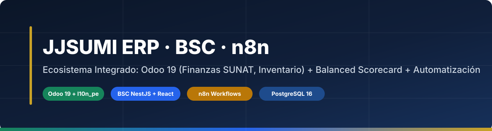
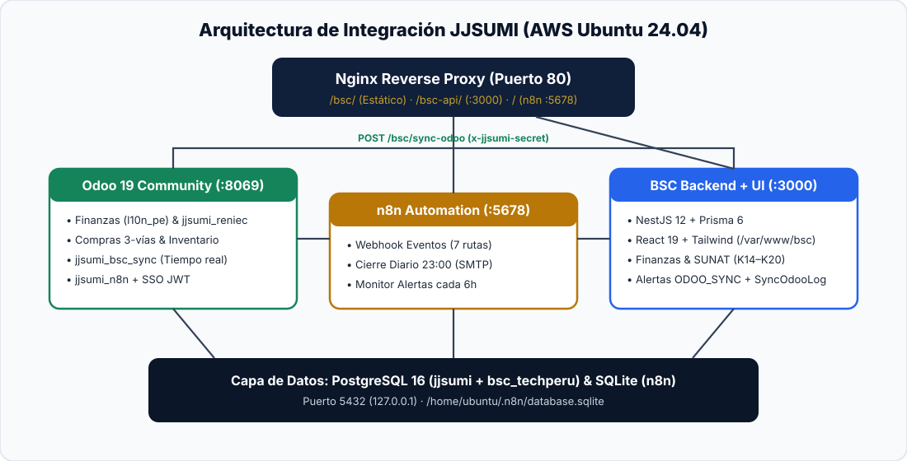

# 06 — Guía Visual, Estilos y Recursos Consolidados

Este documento centraliza la identidad visual, hojas de estilo CSS, íconos y diagramas del ecosistema **JJSUMI (Odoo 19 + BSC + n8n)**.

---

## 1. Paleta de Colores Corporativa

### Odoo 19 ERP (`jjsumi_theme` y `jjsumi_auth`)
- **Navy 900 (Fondo profundo):** `#0B1628`
- **Navy 800 (Barra principal / Botón primario):** `#101F3A`
- **Navy 700 (Hover / Gradiente):** `#16305A`
- **Navy Link:** `#1E4B8C`
- **Dorado Corporativo (Acento):** `#C9A227` (`#A9861B` en hover)
- **Texto Principal:** `#1D2939` · **Secundario:** `#667085`
- **Superficie / Bordes:** `#F7F8FA` / `#E4E7EC`

### Balanced Scorecard — BSC (`BSC-TechPeru-main`)
- **Perspectiva Financiera:** `#16845b` (Esmeralda)
- **Perspectiva Clientes:** `#2563eb` (Azul)
- **Perspectiva Procesos Internos:** `#b97708` (Ámbar)
- **Perspectiva Aprendizaje y Crecimiento:** `#7354c8` (Violeta)

---

## 2. Arquitectura Visual

---

## 3. Inventario de Recursos en `docs/assets/`

| Archivo | Origen / Propósito |
|---|---|
| [`jjsumi-icon.png`](./assets/jjsumi-icon.png) | Ícono oficial del módulo `jjsumi_base` en Odoo 19. |
| [`bsc-vite.svg`](./assets/bsc-vite.svg) | Ícono vectorial del frontend BSC. |
| [`banner-jjsumi.svg`](./assets/banner-jjsumi.svg) | Banner institucional para documentación técnica y ejecutiva. |
| [`arquitectura-jjsumi.svg`](./assets/arquitectura-jjsumi.svg) | Diagrama visual de integración Odoo ↔ n8n ↔ BSC bajo Nginx. |
| [`css/odoo-theme.css`](./assets/css/odoo-theme.css) | Tema corporativo Navy & Gold para el backend de Odoo (`jjsumi_theme`). |
| [`css/odoo-login.css`](./assets/css/odoo-login.css) | Estilos de la pantalla de inicio de sesión (`jjsumi_auth`). |
| [`css/odoo-site.css`](./assets/css/odoo-site.css) | Estilos del portal web comercial (`jjsumi_site`). |
| [`css/bsc-frontend.css`](./assets/css/bsc-frontend.css) | Hoja de estilos principal (Tailwind 4 + clases `.bsc-*`) del frontend BSC. |
